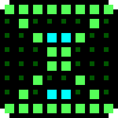
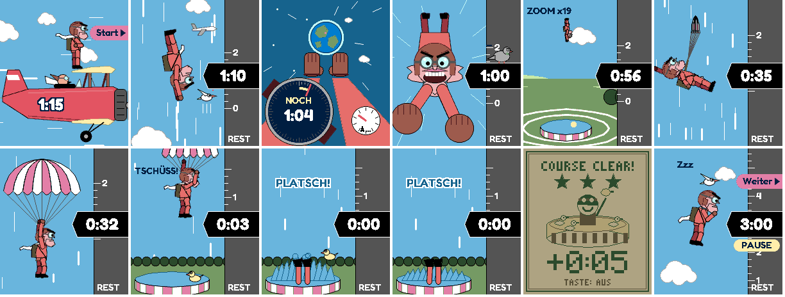
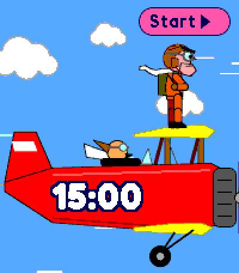
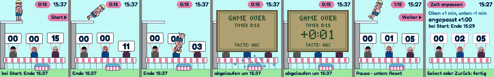
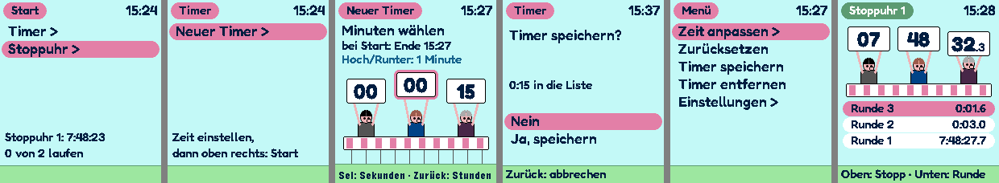

# Timer — Timer und Stoppuhren mit Fallschirmsprung



Timer und Stoppuhren für die **Pebble Time 2**. Beim Start springt ein grimmiger Fallschirmspringer vom
Doppeldecker und landet genau bei 0 im Planschbecken.

> **Beta, Version 0.11.0.** Geprüft im Emulator, der Alltagstest auf der Uhr läuft noch.



*Ansicht Fallschirm (Standard): bereit, Seite, Blick nach unten, frontal, Anflug, Schirm, Eintauchen, Platsch, COURSE CLEAR, Pause.*



*Ablauf im Zeitraffer (Entwurf).*



*Ansicht Water (optional): bereit, Flug, über die Richter, Eintauchen, Game Over, Pause, Zeit anpassen.*



*Auswahl, Timerliste, Eingabe, Rückfrage, Menü, Stoppuhr mit Runden.*

## Was sie kann

- **Timer**: bis zu 5 gleichzeitig, 10 gespeicherte Dauern. Eingabe H:MM:SS, Zeit anpassen um ±1 min im laufenden Timer
- **Stoppuhren**: bis zu 5 gleichzeitig, Runden mit Zehnteln, die letzten 10 je Stoppuhr
- **Fallschirm**: Absprung beim Start, alle 5 s eine andere Sicht, Restzeit auf einem Höhenband wie im Cockpit, Schirm 1 min vor Ende, Platsch bei 0
- **Springer** (Water): Absprung beim Start, Flugbahn nach der verbleibenden Zeit, Eintauchen bei 0. Pause: Er hängt in der Luft
- **Punktrichter**: Stunden, Minuten, Sekunden auf drei Schildern. Wechselt ein Wert, senkt der Richter das Schild und hebt es neu
- **Zeit um**: Kasten im Game-Boy-Stil, Überzeit zählt hoch. Vibration, wahlweise Piepser, Nachklingeln
- **Läuft im Hintergrund weiter**: Ein abgelaufener Timer öffnet die App per Wecker
- **Akku**: Flüssige Bewegung gibt es nur kurz nach einer Taste, in den letzten 10 Sekunden und beim Eintauchen, sonst ein Bild je Sekunde
- **Vier Ansichten**: Fallschirm (Standard), dazu optional Water, Papier (fette Systemschrift, schwarz auf weiß) und Phosphor (Pixelschrift)

## Tasten

| Taste | Timer | Stoppuhr |
| --- | --- | --- |
| Oben | Start · Stopp · weiter | Start · Stopp |
| Unten | Reset (angehalten) | Runde (läuft) · Reset (angehalten) |
| Select | Menü | Menü |
| Zurück | Liste | Auswahl |

Ansicht wechseln: Select lang in der Auswahl → Einstellungen → Ansicht.

## Installieren

`timer.pbw` aus den [Releases](../../releases) laden und am Handy mit der Pebble-App öffnen.

## Bauen

Pebble SDK 4.x, Plattform `emery`:

```bash
pebble build
pebble install --emulator emery
```

Die Fredoka-Schnitte erzeugt `tools/fredoka_schrift.py` aus der variablen Schrift von Google Fonts. Die Bilder der
Ansicht Fallschirm erzeugt `tools/fallschirm_bilder.py` (Pillow) aus den Zeichnungen in `tools/fallschirm_entwurf.py`.

## Schriften und Lizenz

- Code: MIT, siehe `LICENSE`
- Fredoka: SIL Open Font License 1.1, `resources/fonts/OFL.txt`
- Roboto (Ziffern der Ansicht Papier): Apache License 2.0, `resources/fonts/LICENSE-Roboto.txt`
